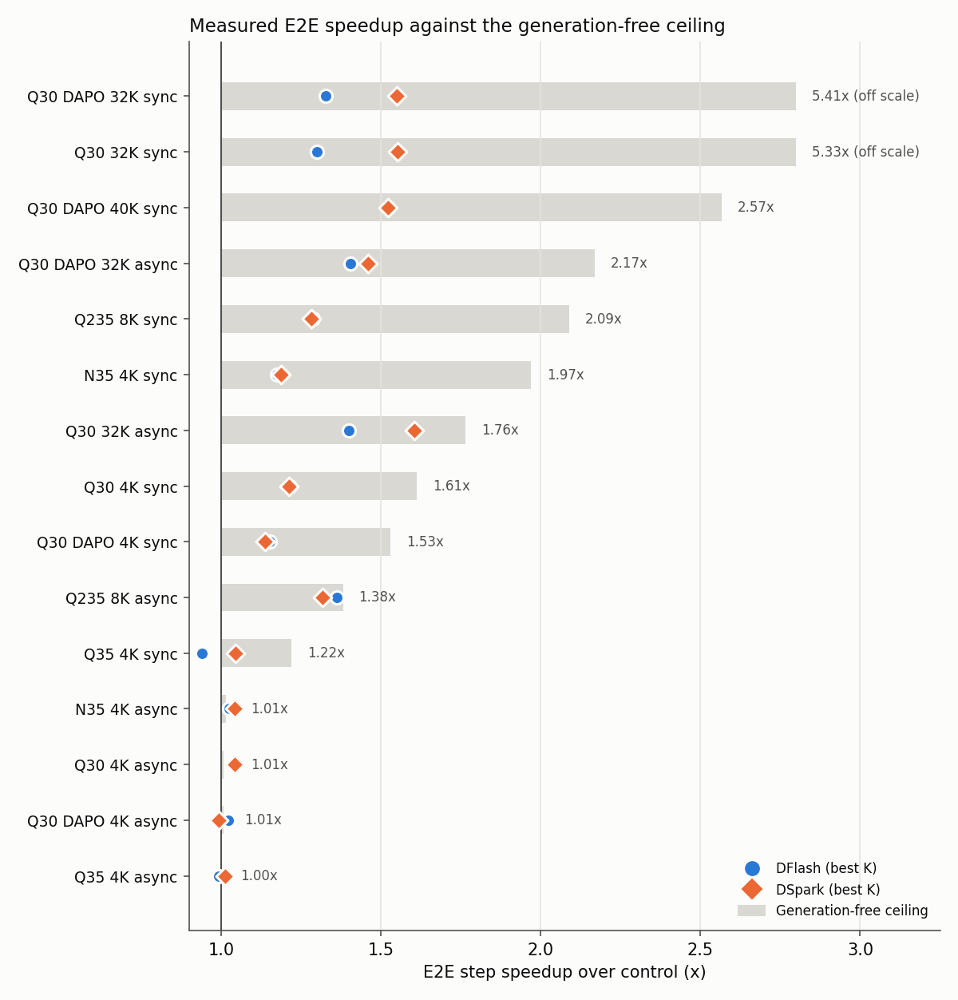
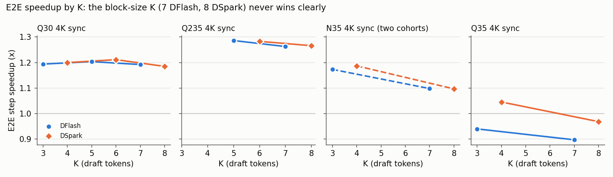

# SpecDec pays off where decode sets the step time, and only there

## Why This Experiment

The DFlash/DSpark draft co-training stack (11 PRs) adds speculative decoding with trained drafters to NeMo RL. This experiment measures how much of the GRPO step this saves on latest main. Each run uses the shipped performance recipe and adds only the SpecDec settings. The models are Qwen3-30B-A3B, Nemotron 3.5 Lightning 30B-A3B, Qwen3.5-35B-A3B and Qwen3-235B-A22B. The workloads are math GRPO and SWE RL. We also find the best K for each drafter. Block size 8 sets the largest K, but not the best K.

Workspace: branch `sna/draft-cotrain-specdec-perf-20261020` on github.com/seonjinn/RL. Live dashboard: https://claude.ai/artifact/GsAcZhvXmCfRq8ETRWutd1.

Code state:

- All runs used the code at `d3ab5836f3`, which merges upstream main `6fcd05f01c`.
- This code holds the merged PRs #3701, #3703, #3706, #3707, #3711 and #3715 through main. It also holds the open PR heads #3723 (`bfbd6d7b21`), #3726 (`c39e31e538`), #3744 (`5dfe9ebe06`), #3750 (`7da56c0ebb`) and #3757 (`5a85b30b05`).
- Two fixes from these runs are on the branch. The draft gate accepts any TP size (`b2264932df`). The venv build tries again after a race between nodes (`844da82424`).
- After the runs, the branch merged upstream main `d643cc4c11` (`f5632d3d95`). This merge adds only MSC checkpoint storage (#4743). `nemo_rl.utils.checkpoint` now imports `multistorageclient` at module load. The vLLM venvs of the 2026-10-20 nightly do not have this package, so this code needs a container built after #4743.
- On 2026-10-22 the open PRs moved to main `d643cc4c11` with review fixes. The new heads are #3723 (`6542b23aac`), #3726 (`c608fd49c9`), #3744 (`9caf100c8b`), #3750 (`725b740614`) and #3757 (`c9c181ba18`). The branch merged them at `30cdfe9e1d`. Then it merged main `f0639c6042`, a one-line CONTRIBUTING.md fix.
- These changes do not touch the measured code paths, so the runs stay valid.

Run settings: OCI-HSG GB200, nightly container, ray.sub, vLLM `moe_backend: flashinfer_trtllm`, CUDA graphs on, 20 steps, no checkpoints, W&B project `sna-async-grpo-gb200`. We compare each arm with the control of its own cohort. The comparison uses the steps 3-20 that both runs logged (SWE: steps 1-20). Speedup is control time divided by arm time.

---

## Workloads and datasets

A workload label names the prompt dataset and the maximum sequence length (prompt plus response). OpenMathInstruct-2 and DAPO-Math-17k are math datasets. The reward checks the final answer. In SWE RL, an agent fixes a repository issue in a container. The task tests give the reward. Q235 math runs use the 8K length of their recipe, not 4K.

| Workload | Dataset | Max length (tokens) | Models | Config |
|---|---|---|---|---|
| OpenMath 4K | OpenMathInstruct-2 | 4,096 | Q30, N35, Q35 | `grpo-qwen3-30ba3b-4n4g.yaml`, `grpo-qwen3.5-35ba3b-2n8g-megatron-ep16tp2cp2.yaml` |
| OpenMath 8K | OpenMathInstruct-2 | 8,192 | Q235 | `grpo-qwen3-235b-16n4g.yaml` (sync), `grpo-qwen3-235b-32n4g-async-1off.yaml` (async) |
| OpenMath 32K | OpenMathInstruct-2 | 32,768 | Q30 | `configs/qwen3_30ba3b/seq32k.yaml` |
| DAPO 4K | DAPO-Math-17k | 4,096 | Q30 | `configs/qwen3_30ba3b/dapo.yaml` |
| DAPO 32K | DAPO-Math-17k | 32,768 | Q30 | `configs/qwen3_30ba3b/dapo_seq32k_*.yaml` |
| DAPO 40K | DAPO-Math-17k | 40,960 | Q30 | `configs/qwen3_30ba3b/dapo40k.yaml` |
| SWE RL | SWE blend `balanced_language.jsonl` (SWE-Gym, SWE-bench, SWE-rebench tasks), OpenHands agent in NeMo Gym | 131,072 | Q30 and Q235 Thinking-2507 | `examples/nemo_gym/grpo_qwen3_30ba3b_thinking_swe2.yaml` |

Models: Q30 is Qwen3-30B-A3B, Q235 is Qwen3-235B-A22B, N35 is Nemotron-3.5-Lightning-30B-A3B, Q35 is Qwen3.5-35B-A3B.

---

## The ceiling decides the gain

Assume that generation takes zero time. Then the step time decreases by the generation share of the control. This gives a generation-free E2E ceiling for each workload. The table shows the best arm for each model, workload, mode and drafter. The last column shows the fraction of the ceiling gain that the arm gets.

| Model | Workload | Mode | Drafter | Best K | Gen share of control | E2E ceiling | E2E | Gen | Accept len | Share of ceiling |
|---|---|---|---|---|---|---|---|---|---|---|
| Q30 | OpenMath 4K | sync | DFlash | 7 | 0.38 | 1.60x | 1.21x | 1.74x | 3.86 | 0.47 |
| Q30 | OpenMath 4K | sync | DSpark | 6 | 0.38 | 1.61x | 1.21x | 1.81x | 3.85 | 0.46 |
| Q30 | DAPO 4K | sync | DFlash | 7 | 0.35 | 1.53x | 1.15x | 1.63x | 3.85 | 0.38 |
| Q30 | DAPO 4K | sync | DSpark | 8 | 0.35 | 1.53x | 1.14x | 1.55x | 4.14 | 0.35 |
| Q30 | DAPO 40K | sync | DFlash | 5 | 0.61 | 2.57x | 1.52x | 2.28x | 3.28 | 0.56 |
| Q30 | DAPO 40K | sync | DSpark | 5 | 0.61 | 2.57x | 1.52x | 2.27x | 3.19 | 0.56 |
| Q30 | OpenMath 32K | sync | DSpark | 8 | 0.81 | 5.33x | 1.55x | 1.75x | 3.57 | 0.44 |
| Q30 | OpenMath 32K | sync | DFlash | 7 | 0.81 | 5.33x | 1.30x | 1.39x | 2.88 | 0.28 |
| Q30 | OpenMath 32K | async | DSpark | 8 | 0.43 | 1.76x | 1.60x | 3.13x | 3.56 | 0.87 |
| Q30 | OpenMath 32K | async | DFlash | 7 | 0.43 | 1.76x | 1.40x | 2.05x | 2.78 | 0.66 |
| Q30 | DAPO 32K | sync | DSpark | 8 | 0.82 | 5.41x | 1.55x | 1.77x | 3.64 | 0.43 (12 paired) |
| Q30 | DAPO 32K | sync | DFlash | 7 | 0.82 | 5.41x | 1.33x | 1.43x | 2.99 | 0.30 (12 paired) |
| Q30 | DAPO 32K | async | DSpark | 8 | 0.54 | 2.17x | 1.46x | 2.46x | 3.62 | 0.58 |
| Q30 | DAPO 32K | async | DFlash | 7 | 0.54 | 2.17x | 1.41x | 2.16x | 2.98 | 0.54 |
| Q235 | OpenMath 8K | sync | DFlash | 5 | 0.52 | 2.09x | 1.29x | 1.62x | 2.78 | 0.43 |
| Q235 | OpenMath 8K | sync | DSpark | 6 | 0.52 | 2.09x | 1.28x | 1.63x | 2.97 | 0.42 |
| Q235 | OpenMath 8K | async | DFlash | 7 | 0.28 | 1.38x | 1.32x | 2.64x | 2.86 | 0.88 |
| Q235 | OpenMath 8K | async | DSpark | 8 | 0.28 | 1.38x | 1.32x | 2.41x | 3.02 | 0.87 |
| N35 | OpenMath 4K | sync | DSpark | 4 | 0.49 | 1.97x | 1.19x | 1.55x | 3.27 | 0.32 |
| N35 | OpenMath 4K | sync | DFlash | 3 | 0.49 | 1.97x | 1.17x | 1.36x | 2.43 | 0.30 |
| Q35 | OpenMath 4K | sync | DSpark | 4 | 0.18 | 1.22x | 1.05x | 1.24x | 2.66 | 0.24 |
| Q35 | OpenMath 4K | sync | DFlash | 3 | 0.18 | 1.22x | 0.94x | 0.74x | 2.59 | below 0 |
| Q30, N35, Q35 | OpenMath 4K, DAPO 4K | async | both | 7-8 | 0.00-0.01 | 1.00-1.01x | 0.99-1.04x | 0.91-1.11x | 3.1-4.1 | n/a |

**The gain follows the generation share, not the drafter.**

- Long outputs (Q30 OpenMath 32K, DAPO 32K and DAPO 40K) and the large model (Q235) give 1.3-1.6x E2E.
- OpenMath 4K sync gives 1.14-1.21x on Q30 and N35. It gives only 1.05x on Qwen3.5-35B, where generation is 18% of the step.
- Async OpenMath 4K is train-bound. Exposed generation is about 1% of the step, so SpecDec has nothing to save. The measured 0.99-1.04x is noise around 1.0x.
- Async runs with a small exposed share (Q235 OpenMath 8K at 0.28, Q30 32K at 0.43) get 0.66-0.88 of their ceiling. Training hides the rest of generation. DAPO 32K async shows 54% of the step as generation and gets 0.54-0.58.
- Sync runs get 0.3-0.6 of their ceiling. A 1.4-2.3x generation speedup cannot remove all of generation.
- On 32K sync, DSpark is faster than DFlash (1.55x against 1.30-1.33x). Its acceptance length is 3.6 against 2.9-3.0.
- On DAPO 32K async, DSpark is about 3% faster (1.46x against 1.41x, generation 2.46x against 2.16x). The two drafters tie on steps 7-14. DSpark is faster on steps 15-20 (1.67x against 1.51x), where the rollout waits are longer.
- Qwen3.5-35B DFlash is the only arm below 1.0x. Its hybrid GDN layers give 46 KV cache groups, and generation becomes slower (0.74x).
- Every arm in this table uses stock vLLM. The GDN metadata-reuse backport lifts Q35 DFlash K3 to 1.02x. This backport is not part of the SpecDec settings.

In every frozen arm, the policy training, logprob and refit times are within 1-4% of the control. This is the expected result. A frozen drafter adds no training work, and the drafter refit is small.

---

## Best K sits 2-4 below the block size

| Model | Mode | DFlash K tried | Best | DSpark K tried | Best |
|---|---|---|---|---|---|
| Q30 | sync | 3, 5, 7 | 5: 1.20x (K3 1.19x, K7 1.19x) | 4, 6, 8 | 6: 1.21x (K4 1.20x, K8 1.19x) |
| Q30 | async | 3, 5, 7 | 7: 1.04x (noise) | 4, 6, 8 | 8: 1.04x (noise) |
| Q235 | sync | 5, 7 | 5: 1.29x (K7 1.26x) | 6, 8 | 6: 1.28x (K8 1.27x) |
| Q235 | async | 7 | 7: 1.32x | 8 | 8: 1.32x |
| N35 | sync | 3, 7 | 3: 1.17x (K7 1.10x) | 4, 8 | 4: 1.19x (K8 1.10x) |
| Q35 | sync | 3, 7 | 3: 0.94x (K7 0.90x) | 4, 8 | 4: 1.05x (K8 0.97x) |

Each row compares K values in one cohort, so all K values in a row share one control. The Q235 K3/K4 sync arms and the Q235 async K sweep are follow-ups (see below). Q30 uses the K-sweep cohort. In the first cohort, DFlash K7 gave 1.22x and DSpark K8 gave 1.20x. Q35 uses the stock-vLLM cohort.

At temperature 1.0, the per-token acceptance is 0.25-0.41. Thus the target rarely accepts the last draft slots, but these slots still cost verify tokens.

- On Q30 the K curve is flat (within 2% from K3 to K8).
- On Q235 the middle K wins by 2-3%.
- On N35 and Q35 the smallest K wins by 4-9%.
- On Q35 only DSpark K4 is faster than the control. DFlash makes the step slower at both K values.

The N35 K3/K4 and K7/K8 arms ran in different cohorts. Thus their gap includes about 2% of baseline drift. **The block-size K is never the clear winner. Use a K 2-4 below the block size.**

---

## SWE RL: measure model calls, not step time

| Model | Arms | Model-call speedup | E2E | Accept len | Steps |
|---|---|---|---|---|---|
| Q30 small (3 nodes) | frozen DFlash K7 / DSpark K8 | 1.05x / 1.24x | 1.06x / 1.04x | n/a | 20 |
| Q30 scale (9 nodes) | frozen DFlash K7 / DSpark K8 | 1.03x / 1.25x | 1.07x / 1.04x | 1.40 / 1.87 | 20 |
| Q30 scale2 (9 nodes) | frozen DFlash K3 / DSpark K4 | 1.00x / 1.30x | 0.90x / 0.90x | 1.28 / 1.76 | 20 |
| Q30 single controller (V2) | frozen DSpark K4 | 1.30x | 1.17x | 2.12 | 20 |
| Q30 scale2 online TP4 | DFlash K3 / DSpark K4 / DSpark K8, lr 1e-4 | 1.28x / 1.31x / 1.22x | 1.05x / 1.07x / 1.00x | 1.66 / 1.76 / 1.84 | 20 |
| Q235 (32 nodes) | frozen DFlash K7 | 1.14x | 1.16x | 1.38 | 11 (all baseline steps) |

Model calls take about one fifth of a SWE trajectory. Thus a 1.3x model-call gain saves about 5% of the trajectory. This gain is smaller than the drift between time windows (next table). Thus the E2E column is not a SpecDec measure on SWE.

**DSpark gives a steady 1.24-1.31x on model calls. DFlash on the Thinking drafter gives 1.00-1.05x on Q30 and 1.14x on Q235.** The DFlash acceptance length is 1.3-1.4, against 1.7-2.1 for DSpark. A Q235 model call spends more of its time in decode, so the same acceptance gives more.

**Online co-training fixes the weak DFlash drafter on SWE.** The DFlash K3 acceptance length starts at the frozen value (1.28 at step 1). From step 6 it is 1.76-1.89. Thus model calls go from 1.00x frozen to 1.28x online. Online DSpark K4 drops at step 2 (1.45). From step 10 it is above the frozen arm (1.9-2.1 against 1.6-2.1).

SWE runs skip the logprob pass. Thus the dashboard leaves the logprob columns of SWE rows empty.

### Final eval, not tool time, moves the SWE step

| Q30 run | Model calls | Tool exec | Agent other | Final eval | Final eval, steps 4-8 | Setup | Trajectory | Step |
|---|---|---|---|---|---|---|---|---|
| scale2 control | 66.7 | 4.6 | 61.0 | 86.4 | 71.0 | 30.2 | 312.9 | 367.4 |
| scale2 frozen DFlash K3 | 67.8 | 5.8 | 59.0 | 111.5 | 180.1 | 30.3 | 340.6 | 408.2 |
| scale2 frozen DSpark K4 | 51.4 | 6.0 | 61.2 | 125.4 | 193.4 | 30.7 | 328.7 | 406.7 |
| scale2 online DFlash K3 | 53.2 | 5.7 | 61.7 | 75.8 | 41.3 | 31.1 | 273.6 | 351.1 |
| scale2 online DSpark K4 | 51.8 | 6.0 | 58.2 | 77.3 | 32.3 | 30.3 | 264.6 | 342.5 |
| scale2 online DSpark K8 | 55.2 | 5.6 | 61.6 | 76.6 | 33.6 | 31.2 | 277.9 | 368.8 |
| V2 control | 69.0 | 5.2 | 65.1 | 85.7 | 56.0 | 31.2 | n/a | 442.0 |
| V2 frozen DSpark K4 | 51.0 | 4.7 | 62.6 | 85.0 | 55.0 | 31.6 | n/a | 377.1 |

Units are seconds per trajectory, mean of steps 1-20 ([data](data/swe_time_breakdown.csv), from `swe_breakdown.py`). Agent other is the OpenHands run time minus model calls and tool execution. Setup is container spin-up plus runtime create, connect and init. Ray queue time is 1.1-1.4 s in all runs. The V2 path does not log the trajectory time. Its step is the trainer step, which also includes policy training (29-33 s).

SpecDec changes one column. DSpark and online DFlash cut model calls from 67-69 s to 51-55 s. Tool execution is 4.6-6.0 s in every run, so tool time does not explain an E2E gap. Agent other and setup are also flat. Final eval is the column that moves:

- Outside steps 4-8, final eval is 87-103 s in all scale2 runs.
- In steps 4-8, final eval is 180-193 s in the two frozen arms and 71 s in the control. The online arms take 32-41 s.
- The two frozen arms ran in the same window (18:46-21:38 on 2026-10-21). The online DFlash K3 and DSpark K8 arms ran together on 2026-10-22 (05:54-08:21).

Final eval runs the tests of each patch in a container on shared nodes. Thus the data agrees with a window effect, not an arm effect. **The scale2 E2E column (0.90x frozen, 1.05-1.07x online) compares time windows, not drafters.** The V2 pair ran in windows that overlap, and its final eval times match (85.7 s against 85.0 s). Thus its 1.17x is the cleanest SWE step number. The V2 window-2 jobs (follow-ups) run the control and four arms at one commit in one window to test this.

### The model-call gain is real, the step gain is mostly noise

Agent runs differ from run to run. An agent can take more turns, a command can fail, or a final eval can time out. Thus we check two things:

1. Does the workload differ between arms?
2. Is the gain larger than the step-to-step spread?

Each step pairs the same prompts in the arm and in its control. The 90% interval comes from a bootstrap resample of the 20 paired steps.

| Q30 run | Turns | Gen tokens | Masked | Model-call ratio [90%] | Steps faster | Model-call steps 11-20 [90%] | Step ratio [90%] | Steps faster |
|---|---|---|---|---|---|---|---|---|
| scale2 control | 11.3 | 14,953 | 4.1% | 1 | | 1 | 1 | |
| scale2 frozen DFlash K3 | 12.0 | 15,248 | 3.6% | 1.01x [0.99, 1.03] | 12/20 | 1.00x [0.97, 1.03] | 0.90x [0.73, 1.11] | 7/20 |
| scale2 frozen DSpark K4 | 11.2 | 15,034 | 4.8% | 1.31x [1.28, 1.34] | 20/20 | 1.31x [1.25, 1.36] | 0.90x [0.74, 1.10] | 10/20 |
| scale2 online DFlash K3 | 11.4 | 15,291 | 3.6% | 1.30x [1.24, 1.36] | 20/20 | 1.42x [1.38, 1.45] | 1.05x [0.92, 1.23] | 9/20 |
| scale2 online DSpark K4 | 11.3 | 15,190 | 3.6% | 1.31x [1.26, 1.36] | 20/20 | 1.40x [1.36, 1.44] | 1.07x [0.95, 1.24] | 9/20 |
| scale2 online DSpark K8 | 11.5 | 15,079 | 3.4% | 1.22x [1.18, 1.26] | 19/20 | 1.30x [1.26, 1.33] | 1.00x [0.84, 1.21] | 7/20 |
| V2 control | 11.6 | 15,497 | 3.8% | 1 | | 1 | 1 | |
| V2 frozen DSpark K4 | 11.6 | 14,882 | 3.8% | 1.32x [1.27, 1.36] | 20/20 | 1.32x [1.28, 1.35] | 1.17x [1.04, 1.35] | 14/20 |

Values are means of steps 1-20, except the steps 11-20 column ([data](data/swe_variation.csv), from `swe_variation.py`). Masked is the share of trajectories that the agent server drops from training.

The workload is the same in every run. Each step has 11.2-12.0 turns, 14.9-15.5K generated tokens and 3.4-4.8% masked trajectories. No run has truncated trajectories or failed vLLM generations. More turns make model calls slower (per-step correlation -0.47 in the scale2 control). But the turn counts match, so the workload does not explain the gain. Two independent controls give 225.7 and 226.1 tok/s. Two independent frozen DSpark K4 runs give 295.7 and 297.2 tok/s. **Model-call tok/s repeats within 0.5% across runs. DSpark is faster in each of the 20 paired steps. Thus its 1.3x is a real SpecDec gain.** Frozen DFlash K3 stays inside the noise (1.01x).

**The online drafters are faster at the end of the run than the 20-step mean shows.** In steps 11-20, online DFlash K3 gives 1.42x and online DSpark K4 gives 1.40x. Frozen DSpark K4 gives 1.31x in both windows. Thus the step 1-20 mean hides a 7% online gain over frozen DSpark. The frozen arms have the same ratio in steps 1-20 and in steps 11-20. Thus the late gain does not come from the time of the run.

Step time is different. Async step times alternate between short and long steps. The per-step spread is 103-118% of the mean. In every run, the slowest final evals reach the 1200 s eval timeout. **Only the V2 step ratio is above 1 at 90%. Its interval is 1.04x to 1.35x.** The 90% intervals of all scale2 step ratios include 1. The window-2 jobs give the first E2E comparison with all arms in one window.

---

## Online co-training

The first online arms did not train the drafter. On the Megatron path, the draft parameters inherited the policy lr (3e-7). With the draft lr at 1e-4 and the policy at TP1, our implementation and the teammate's implementation give the same result.

| Arm (Q30 TP1) | Impl | Gen | Step | Accept len | Paired |
|---|---|---|---|---|---|
| DFlash K7 | teammate | 1.71x | 1.15x | 3.62 | 18 |
| DFlash K7 | ours | 1.68x | 1.14x | 3.62 | 18 |
| DSpark K8 | teammate | 1.67x | 1.13x | 4.00 | 18 |
| DSpark K8 | ours | 1.60x | 1.13x | 4.01 | 18 |
| DFlash K7, draft lr 1e-5 | ours | 1.70x | 1.14x | 3.80 | 18 |

The DSpark K8 generation ratios differ (1.60x against 1.67x) with the same acceptance length. The cause is a difference between the two baselines. Arm generation is 38.3 s against 37.4 s, and baseline generation is 61.2 s against 62.3 s. Both differences are inside the 1.3-2.7% drift between jobs. Drafter training adds 9-12% to policy training time in both implementations.

**The draft lr sets the early dip, not the gain.**

- At lr 1e-4, the DFlash acceptance length drops from 3.92 at step 1 to 3.25 at step 3. It recovers to 3.66 by step 20. The draft loss peaks at 2.30 at step 2 and ends at 1.90.
- At lr 1e-5, the acceptance length stays at 3.72-3.94 for all 20 steps. The draft loss is 1.70-1.94.
- Both stay below the untrained drafter (3.86 in the earlier run, where the draft inherited lr 3e-7).

The drafter already fits math outputs well, so 20 steps of math rollouts add little. Step time is the same (1.14x). Generation is 25% of the arm step, and the 5% higher acceptance length cuts generation by only 1.4%.

SWE online arms ran out of memory at TP2. The old draft gate forced TP2. At the baseline TP4 layout, all three online SWE arms pass. Over 20 paired steps, DSpark K4 keeps the frozen model-call gain (1.31x against 1.30x). In steps 11-20 it is ahead of the frozen arm (1.40x against 1.31x). Its training takes 13% longer than the control and 9% longer than the frozen arm.

---

## Suspicious outcomes

| Outcome | Why it is suspicious | Status |
|---|---|---|
| Async OpenMath 4K arms show 1.03-1.04x E2E | Exposed generation is about 1% of the step, so the ceiling is 1.01x. The gain is noise or a side effect, not SpecDec. | explained |
| SWE scale2 frozen arms 0.90x E2E with 1.30x model calls | Final eval in steps 4-8 takes 180-193 s in both frozen arms, which ran in one window, against 71 s in the control. Tool execution is 4.6-6.0 s in all arms. | explained (final-eval window drift), V2 window-2 rerun queued |
| SWE online DFlash K3 acceptance 1.66, far above the frozen arm (1.28) | Per-step values start at 1.28 and climb to 1.76-1.89 by step 6. The drafter adapts to SWE outputs during training. | real effect, online gain |
| SWE online DSpark K4 TP4 1.07x E2E, above the frozen arm (0.90x) | Model calls are 1.30-1.31x in both, and training is 9% longer than frozen. The E2E gap is final eval in different windows (32 s against 193 s in steps 4-8). | explained, use model call 1.31x |
| SWE logprob 1.13-1.33x longer in arms | SWE skips the logprob pass, and the control timer logs 0.5-1.2 ms per step. | fixed: the dashboard leaves a ratio empty when the control phase is under 0.5 s |
| DSpark draft loss differs between implementations by about 0.26 | The teammate TV term is sum\|p-q\|. Ours is 0.5*sum\|p-q\|. | explained, values not comparable |
| Two baselines 1.3-2.7% apart | Same config, different jobs. | compare inside a cohort only |
| SC (V2) single pair | One baseline and one arm. | needs a repeat |
| Q235 SWE fits 11 steps in 4 h, and E2E (1.16x) is above model call (1.14x) | Async step times alternate between 60-80 s and 870-1430 s. Steps 1-6 give 1.02x and steps 7-11 give 1.30x, so part of the E2E gain is rollout wait. | use model call 1.14x |
| 8150978 step-1 generation 238x | Async step 1 pairs a buffered step with a fresh one. | excluded by the paired window |
| DAPO 32K async baseline waits at steps 3 and 5 (412 s exposed generation against 2 s) | Its slower generation has not caught up yet. From step 7 all runs alternate in phase. Steps 7-20 give DFlash 1.43x and DSpark 1.48x, against 1.41x and 1.46x over steps 3-20. | explained, gain holds in steady state |
| DAPO 32K sync pairs on 12 steps | The baseline (8146971) hit the 4 h limit at step 14. | above the 8-step floor |
| Q35 DFlash slower than control at K3 and K7 | The GDN layers give 46 KV cache groups. The GDN metadata-reuse backport gives 1.4-1.8x on rollout and lifts K3 to 1.02x. | root cause known, fix not in stock vLLM |
| Q235 sync DFlash K3 and DSpark K4 died at startup | megatron-core editable build race between nodes of one job. | fixed in 844da82424, reruns are follow-ups |

---

## Follow-ups still queued

These jobs were PENDING on OCI-HSG on 2026-10-22, when the report closed. The results above do not include them. Most of them refine K or repeat a cohort. Q235 SWE DSpark K8 is the exception. It is the one drafter that the Q235 SWE comparison does not have yet. The Q30 SWE V2 window-2 jobs run at commit 15dbc21d1a. They test the final-eval window effect. Frozen DSpark K4 joins them after the control runs for 15 minutes.

| Job | Run | Adds |
|---|---|---|
| 8146563-8146568 | q235-sd1020-ksweep-async-frozen-{dflash-k3,k5,k7,dspark-k4,k6,k8}-s128 | Q235 async K sweep |
| 8150700, 8151041 | q235-sd1020-ksweep-frozen-dflash-k3-r2, dspark-k4-r2 | Q235 sync smallest K |
| 8149970 | swe235-sd1020-frozen-dspark-k8-v10 | Q235 SWE DSpark |
| 8155964 | swe-sd1020-scale2-r16-online-dflash-k7-lr1e4-tp4 | SWE online DFlash at the block-size K |
| 8168006-8168009 | swe-sd1022-sc-r16-{baseline,frozen-dflash-k3,online-dflash-k3-lr1e4-tp4,online-dspark-k4-lr1e4-tp4} | Q30 SWE V2 window 2, one commit, one window |

---

## Key Takeaway

**SpecDec speeds up GRPO by about the share of the step that is exposed decode.** It gives 1.3-1.6x E2E for long outputs and Q235. It gives 1.14-1.21x for OpenMath 4K sync on Q30 and N35, and 1.05x on Qwen3.5-35B. It gives no gain for train-bound async OpenMath 4K. DFlash and DSpark tie on OpenMath 4K. DSpark wins on long outputs (32K sync 1.55x against 1.30-1.33x, DAPO 32K async 1.46x against 1.41x) and on SWE model calls. On SWE, online co-training lifts the DFlash acceptance length from 1.28 to about 1.85 in 6 steps. It also lifts the model-call speedup from 1.00x to 1.28x over 20 steps and to 1.42x in steps 11-20. Online DSpark K4 reaches 1.40x in steps 11-20, against 1.31x frozen. A K below the block size is as good or slightly better. Thus the block-size K is a safe default, but not the best K. The next lever is not a better drafter for 4K async math, because that workload has no generation left to hide. The next lever is long-output and agentic workloads, where decode or model calls set the step time.